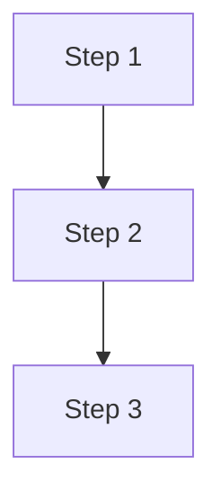
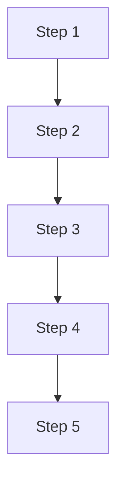
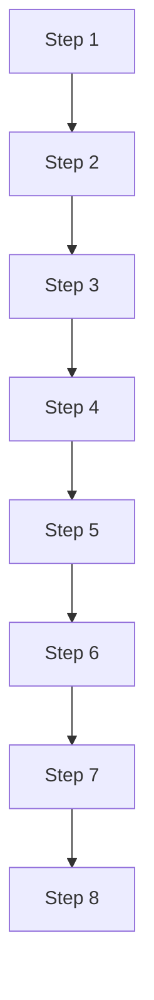
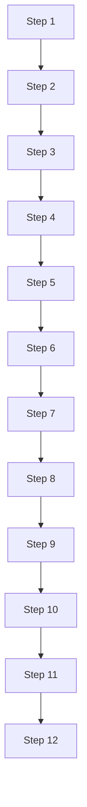
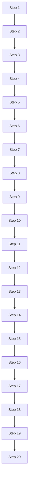
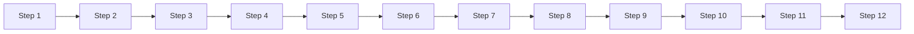
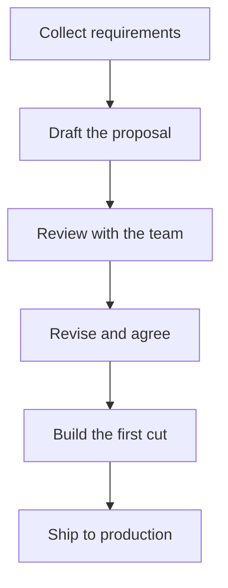
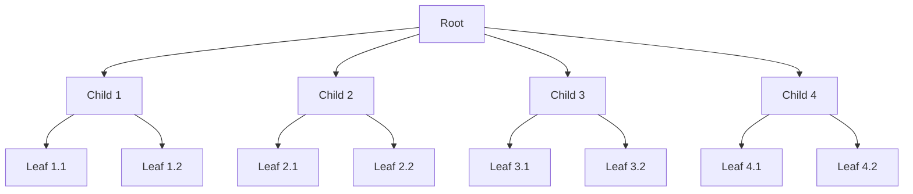
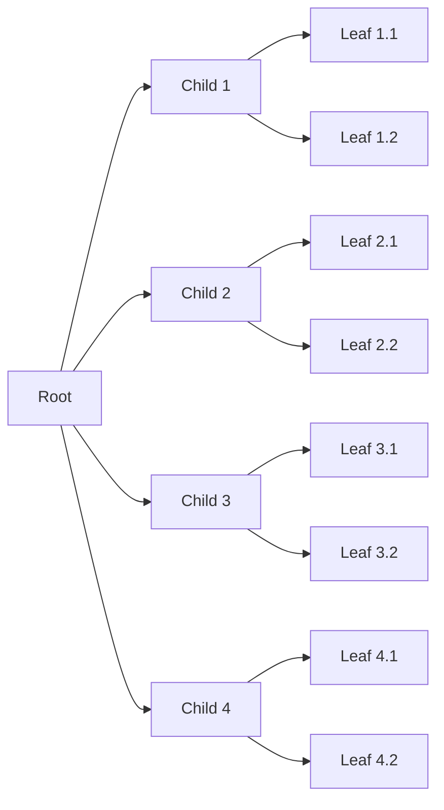

# Mermaid frame test

Each chart uses `layout: dagre`.

## 1. TB chain, 3 nodes

End of chart 1.

## 2. TB chain, 5 nodes

End of chart 2.

## 3. TB chain, 8 nodes

End of chart 3.

## 4. TB chain, 12 nodes

End of chart 4.

## 5. TB chain, 20 nodes

End of chart 5.

## 6. LR chain, 3 nodes

End of chart 6.

## 7. LR chain, 5 nodes

End of chart 7.

## 8. LR chain, 8 nodes

End of chart 8.

## 9. LR chain, 12 nodes

End of chart 9.

## 10. LR chain, 6 nodes, long labels

End of chart 10.

## 11. TB chain, 6 nodes, long labels

End of chart 11.

## 12. TB tree, 4 children x 2 leaves

End of chart 12.

## 13. LR tree, 4 children x 2 leaves

End of chart 13.
