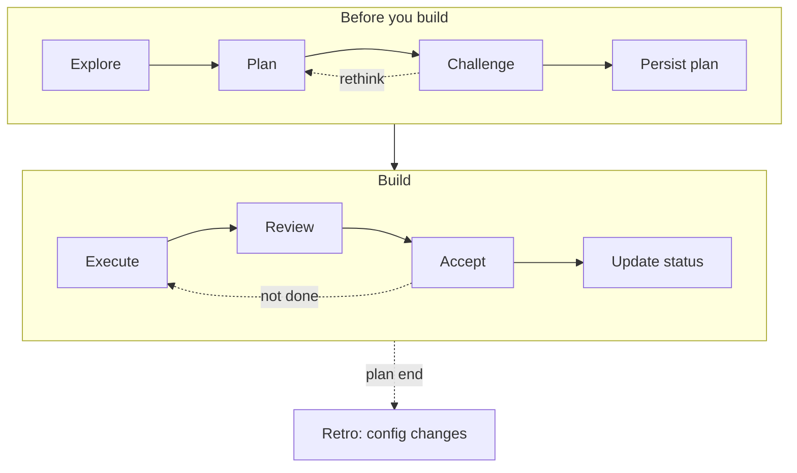
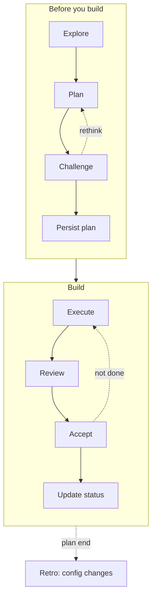
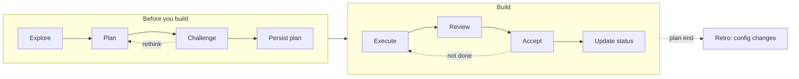
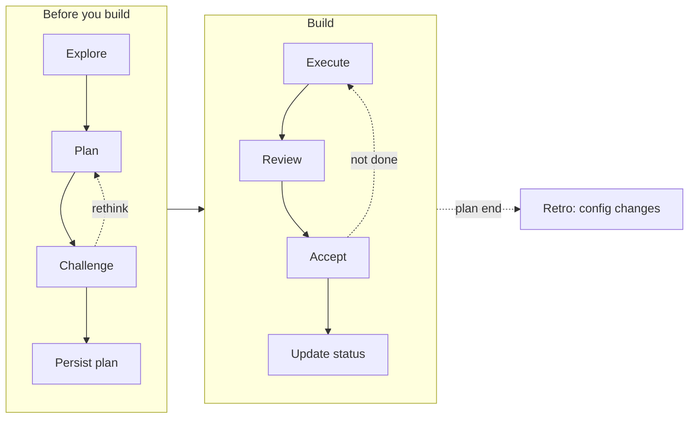
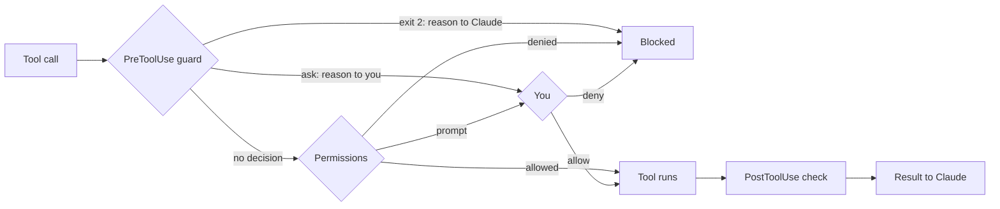
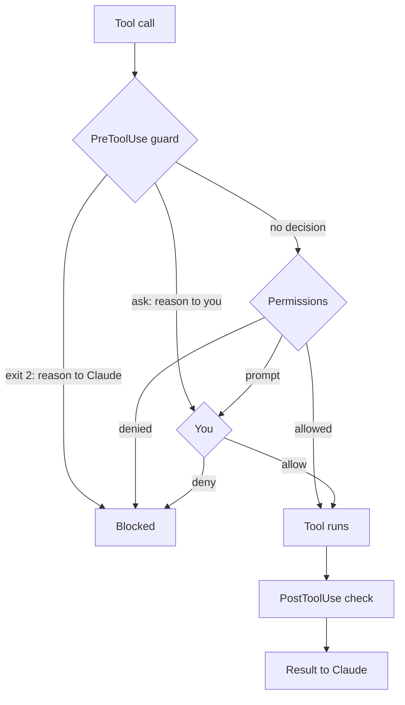

# Methodology diagrams, both directions

## 1. §2 core loop: current (outer TB, stages LR)

End of chart 1.

## 2. §2 core loop: outer TB, stages TB

End of chart 2.

## 3. §2 core loop: outer LR, stages LR

End of chart 3.

## 4. §2 core loop: outer LR, stages TB

End of chart 4.

## 5. §6 hook flow: current (LR)

End of chart 5.

## 6. §6 hook flow: TB

End of chart 6.
